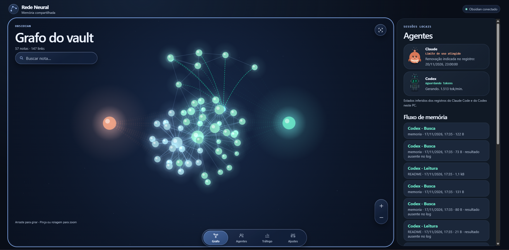
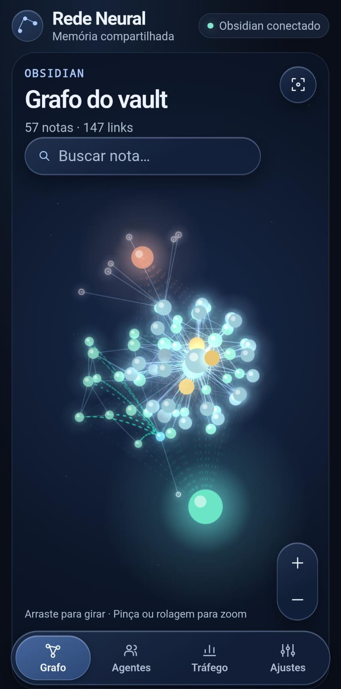

# Rede Neural · Escritório dos Agentes

**Explore em 3D as notas do seu vault Obsidian e acompanhe a atividade local do Claude Code e do Codex.** Use o app no Android ou abra o painel no navegador do computador.

## Baixar

**[Baixar tudo em um ZIP](https://github.com/thiagopauluk200/escritorio-dos-agentes/releases/latest/download/Rede-Neural-Kit.zip)** — inclui o APK assinado, o Conector Windows e os hashes dos arquivos.

| Download | Para que serve |
| --- | --- |
| [APK Android](https://github.com/thiagopauluk200/escritorio-dos-agentes/releases/latest/download/RedeNeural-Android.apk) | Instale no celular ou tablet com Android 8 ou superior e Android System WebView atualizado. |
| [Conector Windows x64](https://github.com/thiagopauluk200/escritorio-dos-agentes/releases/latest/download/Conector-Rede-Neural-Windows.zip) | Abra o vault no PC, gere o QR de pareamento e inicie o painel. O Python vem incluído. |
| [SHA-256](https://github.com/thiagopauluk200/escritorio-dos-agentes/releases/latest/download/SHA256SUMS.txt) | Confira a integridade dos downloads. |
| [Releases](https://github.com/thiagopauluk200/escritorio-dos-agentes/releases) | Veja as mudanças e baixe versões anteriores. |

## Rede Neural no computador e no celular

<p align="center">
  <a href="docs/imagens/rede-neural-web.png"></a>
  &nbsp;&nbsp;&nbsp;&nbsp;
  <a href="docs/imagens/rede-neural-android.jpg"></a>
</p>

[Instalar e conectar](#instalar-e-conectar) · [Obsidian e MCP](#integrar-o-obsidian-e-o-mcp) · [Rodar em Python](#rodar-a-partir-do-código-em-python) · [Resolver problemas](#resolver-problemas)

## Instalar e conectar

### 1. Prepare o computador

Se baixou o kit completo, extraia o kit e depois o ZIP do Conector.

1. Extraia o ZIP do Conector e abra **Abrir-Conector.bat**.
2. No Obsidian, abra o vault que deseja visualizar. No Conector, selecione **a mesma pasta do vault**, a que contém a pasta oculta `.obsidian`.
3. Clique em **Iniciar conexão** e deixe a janela aberta. Se o Windows pedir acesso à rede, escolha redes privadas.

O Conector mostra o QR e o endereço do painel. A escolha do vault já permite visualizar as notas. A integração com o plugin adiciona os links resolvidos pelo Obsidian.

### 2. Pareie o Android

1. Instale o **APK Android**. Se o sistema pedir permissão para instalar a partir do navegador ou gerenciador de arquivos, autorize a origem que você usou para abrir o APK.
2. Coloque o Android e o PC na mesma rede local. No app, toque em **Ler QR com a câmera**, fotografe o QR inteiro da janela do Conector e confirme a foto.
3. Crie a conta local com um usuário e uma senha de pelo menos 12 caracteres. Em outros Androids pareados ao mesmo Conector, use **Entrar** com essa conta.

Se preferir, use **Copiar código** no Conector. Transfira-o por um meio privado e, no app, toque em **Usar código manual**, cole e escolha **Verificar conexão**. Quem já está conectado pode conferir o QR em **Ajustes → Conta e computador → Testar QR do Conector**.

[Guia oficial de instalação e verificação no Android](https://developer.android.com/developer-verification/guides?hl=pt-BR)

### 3. Abra o painel web

1. No Conector, clique em **Abrir painel web**. O endereço padrão no PC é [127.0.0.1:8772](http://127.0.0.1:8772/). Se a porta estiver ocupada, vale o endereço exibido na janela.
2. Clique em **Copiar chave web** e cole a chave na página de entrada.

O painel web é local ao computador. A chave web dá acesso ao navegador, e o QR ou código manual serve para o pareamento do Android.

## Integrar o Obsidian e o MCP

### Ative o índice do Obsidian

1. Abra o vault no Obsidian e vá a **Configurações → Plugins da comunidade**.
2. Procure **Local REST API with MCP**, instale e ative o plugin.
3. No Conector, confirme que a pasta selecionada é a raiz desse vault. Deixe o Obsidian aberto para carregar os metadados e os links resolvidos.
4. Abra **Ajustes** na Rede Neural e confira a origem do grafo. O Conector usa as configurações e o certificado locais do plugin. Se o serviço estiver indisponível, ele lê as notas em disco.

[Documentação do plugin Local REST API with MCP](https://github.com/coddingtonbear/obsidian-local-rest-api)

### Conecte Claude Code e Codex ao vault

O app monta o grafo mesmo sem configurar os agentes. Para acompanhar as chamadas à memória, conecte o MCP aos clientes que você usa no PC do Conector.

1. Faça login no cliente oficial com `claude auth login` ou `codex login`, conforme necessário.
2. Abra as configurações do plugin no Obsidian e copie a **chave de API do plugin**. Use o servidor MCP HTTPS padrão `https://127.0.0.1:27124/mcp/` se os clientes confiarem no certificado local do plugin.
3. Para configurar o exemplo abaixo, habilite **Enable HTTP server** no plugin e mantenha o serviço restrito ao próprio PC. O endereço HTTP padrão é `http://127.0.0.1:27123/mcp/`. Se você alterou a porta no Obsidian, use a porta configurada.

No PowerShell 7, leia a chave em uma variável de ambiente da sessão e registre o servidor em um ou nos dois clientes:

```powershell
$env:OBSIDIAN_API_KEY = Read-Host -MaskInput "Chave de API do plugin Obsidian"

codex mcp add obsidian --url [http://127.0.0.1:27123/mcp/](http://127.0.0.1:27123/mcp/) --bearer-token-env-var OBSIDIAN_API_KEY

claude mcp add --transport http --scope user obsidian [http://127.0.0.1:27123/mcp/](http://127.0.0.1:27123/mcp/) --header 'Authorization: Bearer ${OBSIDIAN_API_KEY}'
